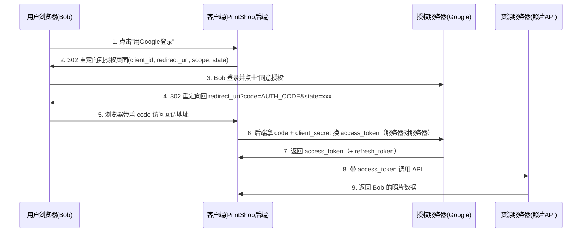

# 第 2 章：OAuth 演变史 —— 从一场事故到一个协议

> 本章是理论章（无 Demo），但它是理解第 4 章"手写 OAuth2 服务器"的钥匙。
> 读完本章你将明白：OAuth 为什么长成今天这个样子——**每个看似奇怪的细节，都是为了堵住一个真实的安全漏洞**。

---

## 2.1 起点：用户想把照片导入打印店

2006 年前后，故事是这样的：

- Bob 的照片存在 **Google Photos**（资源提供方）；
- 他想用一家在线打印服务 **PrintShop**（第三方应用）帮他把照片印出来；
- PrintShop 说："请把你的 Google 账号密码给我，我们去拉照片。"

Bob 犹豫了。把密码给出去，意味着：

1. **PrintShop 拿到了全部权限**——它其实只需要"读照片"，却可以删照片、改密码、发邮件；
2. **Google 无从区分**——PrintShop 用 Bob 的密码登录，在 Google 眼里就是"Bob 本人"；
3. **密码无法撤销**——除非 Bob 改密码，否则收不回授权；一改密码，所有第三方应用全部失效；
4. **信任问题**——万一 PrintShop 数据库被黑，Bob 的密码泄露（撞库攻击，殃及 Google 账号）。

> **生活类比**：你想让快递员进小区送包裹，结果把家里钥匙连保险柜密码全给他了。
> 合理的做法是什么？给他一张**只能开单元门、限时有效、可随时作废**的临时通行卡。

这个"临时通行卡"的思路，就是 OAuth 的灵魂。

---

## 2.2 OAuth 1.0（2007）：用签名证明"我没偷看"

2007 年，Twitter 开放 API 时发布了 OAuth 1.0（2010 年成为 RFC 5849）。
它解决的核心问题是：**如何让第三方应用证明"是我（而不是别人冒充）在代表用户取数据"，同时全程不用传密码？**

### 角色

- **Service Provider（服务提供方）**：Google，分两层——请求令牌 + 受保护资源；
- **Consumer（消费者）**：PrintShop，事先在 Google 注册过，持有 `consumer_key` 和 `consumer_secret`；
- **User（用户）**：Bob。

### 流程（三步换凭证）

```
① Consumer 向 Google 请求"未授权的 Request Token"
② 带着用户去 Google 授权页面，用户登录并同意
③ Consumer 拿授权过的 Request Token 换 Access Token
④ 之后每次访问资源，都带上"签名"
```

### 签名机制（关键！）

每次请求，Consumer 要用只有它和 Google 知道的 `consumer_secret` + `token_secret`，
对**请求的全部内容**（URL、参数、时间戳、nonce 等）计算一个 **HMAC-SHA256 签名**：

```
signature = HMAC-SHA256(base_string, consumer_secret + "&" + token_secret)
```

Google 收到请求后用同样的算法和密钥重算一遍，比对签名。

**为什么这样做？**

- 中间人截获了请求，能拿到参数和签名，但**没有密钥**，无法伪造下一个请求；
- 换句话说，**凭证（secret）从不离开双方**，网络上传输的只是"签过名的请求"。

### OAuth 1.0 的死穴

聪明，但是——

1. **实现复杂**：base_string 的拼接规则（参数排序、URL 编码顺序）极易出错，当年无数开发者踩坑；
2. **每个请求都要签名**：服务端要解析全部参数重算签名，性能开销大；
3. **不区分场景**：没有"服务器端 Web 应用 / 浏览器应用 / 移动 App / 服务对服务"的区分，一套流程套所有场景；
4. **难以扩展**：想加新能力就要动协议本身。

于是社区痛定思痛：**把"防伪造"的职责从"每次签名"改成"只在换 Token 的那一刻用 HTTPS 保护一次"，其余时间靠短时效的 Token 本身。**

这就是 OAuth 2.0 的哲学转变：**简化客户端，把安全性交给 TLS（HTTPS）+ 令牌生命周期管理。**

---

## 2.3 OAuth 2.0（2012）：按场景分流，RFC 6749

OAuth 2.0（RFC 6749）做了三件大事：

1. **重新定义角色**（这套名字贯穿所有后续标准，务必记住）：

| 角色 | 通俗说法 |
|------|---------|
| Resource Owner（资源所有者） | 用户 Bob |
| Client（客户端） | 第三方应用 PrintShop |
| Authorization Server（授权服务器） | 发通行证的（Google 的授权服务） |
| Resource Server（资源服务器） | 存数据的（Google 的照片 API） |

2. **把授权方式拆成 4 种"授权模式"（Grant Type）**，按客户端类型选；
3. **引入 scope（权限范围）**：授权可以细粒度——"只读照片，不删照片"。

### 四种授权模式总览

| 模式 | 英文 | 适用场景 | 特点 |
|------|------|---------|------|
| 授权码模式 | Authorization Code | 有后端的 Web 应用（**最常用、最安全**） | 授权码换 Token，两步走 |
| 简化模式 | Implicit | 纯前端应用（无后端） | 直接返回 Token，**已不推荐** |
| 密码模式 | Resource Owner Password Credentials | 高度信任的第一方应用 | 用户把密码给客户端换 Token，**已废弃**（OAuth 2.1） |
| 客户端凭证模式 | Client Credentials | 服务对服务的机器调用（无用户参与） | 应用以"自己"的身份拿 Token |

### 2.3.1 授权码模式（重中之重）



**为什么要绕一圈先给 code 再换 Token？** 这是整个协议最精妙的设计：

- code 会先经过**浏览器**（前端），access_token 绝不经过浏览器；
- code 是**一次性**的、几分钟内过期；
- 换 Token 的一步在**服务器之间**进行，附带 `client_secret`，攻击者即使在浏览器截获 code，没有 secret 也换不到 Token；
- 配合 `state` 防 CSRF、配合 PKCE 防截获（第 7 章详解）。

> **类比**：授权码是"取件码"，Token 是"包裹"。取件码会贴在公告栏（浏览器可见），
> 但取包裹必须凭"会员卡 + 取件码"（client_secret + code）在后柜（服务器间）完成。公告栏上的人看到取件码也没用。

### 2.3.2 其他三种模式速览

**Implicit（简化模式）**：历史上给纯前端 SPA 用的——浏览器应用存不了 `client_secret`（JS 代码人人可见），干脆省掉换 Token 那步，授权完直接把 Token 拼在回调地址里。
问题：Token 暴露在浏览器历史/日志/Referrer 里，且无法安全刷新。**已不推荐，被"授权码 + PKCE"取代。**

**Password（密码模式）**：用户直接把账号密码给客户端，客户端拿密码换 Token。
适合"同一个公司的第一方应用"。但违背了 OAuth"密码不出手"的初衷，**OAuth 2.1 已将其移除**。

**Client Credentials（客户端凭证模式）**：没有用户参与，应用以"自己"的身份拿 Token，例如定时任务调用内部 API：

```
POST /token
  grant_type=client_credentials
  client_id=xxx&client_secret=yyy
→ { "access_token": "...", "expires_in": 3600 }
```

### 2.3.3 Refresh Token：Token 过期了怎么办？

Access Token 短时效（如 1 小时）是安全设计，但用户不能每小时重新点一遍"授权"。
于是引入 **Refresh Token（长期、存储在服务端）**：

```
access_token 过期 → 客户端用 refresh_token 调 /token（grant_type=refresh_token）→ 静默换新 access_token
```

关系类比：Access Token 是"当日门票"，Refresh Token 是"年卡"——
年卡丢了大不了挂失重办，当日门票丢了损失有限。

---

## 2.4 OAuth 2.1（进行中）：把"安全最佳实践"焊死在协议里

OAuth 2.1（草案）不是新协议，而是对 2.0 的"收编"：

| 变化 | 说明 |
|------|------|
| ❌ 删除 Password 模式 | 密码不出手 |
| ❌ 删除 Implicit 模式 | 纯前端也用"授权码 + PKCE" |
| ✅ PKCE 成为标配 | 所有客户端（包括机密客户端）都建议加 PKCE |
| ✅ 明确 Redirect URI 精确匹配 | 防重定向劫持 |
| ✅ Bearer Token 用法规范化 | RFC 6750 |

趋势很清楚：**协议本身越来越简单，安全越来越严格。**

---

## 2.5 悬而未决的问题：OAuth2 只管授权，不管"你是谁"

注意一个微妙但关键的点：**OAuth2 是授权协议，不是认证协议。**

它回答的是："PrintShop 可以用 Bob 的 Token 去拿 Bob 的照片。"
它**没有**回答："这个 Token 对应的人到底是谁？他叫什么？邮箱是什么？"

所以各大平台各自魔改：GitHub 发一个 `/user` 接口，微信发一个 `openid`……字段五花八门，每接一个平台就要读一遍它的文档。

**如何把"认证"标准化地叠在 OAuth2 之上？** 答案是 OIDC（第 6 章）。
但在那之前，我们先要弄清楚两种最基础的凭证方案——Session 与 JWT（第 3 章），
因为手写 OAuth2 服务器（第 4 章）时两者都要用到。

---

## 2.6 本章小结

- OAuth 的诞生动机：**用户不该把密码交给第三方**；
- OAuth1.0 用"每请求签名"防伪造——安全但复杂；
- OAuth2.0 转变哲学：**HTTPS + 短时效 Token + 按场景分流的四种授权模式**；
- 授权码模式是核心：code（可暴露给浏览器）→ Token（只在服务器间传递）；
- OAuth2 只管授权不管认证，这个坑由 OIDC 来填。
