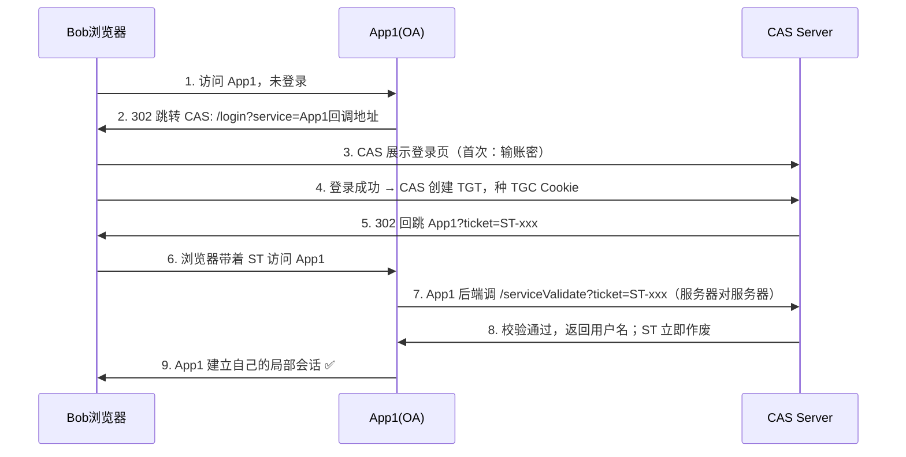

# 第 5 章：CAS 与 SAML —— 企业级 SSO 的两大经典方案

> 配套实验：[Demo5 - CAS 最小实现](../demos/05-cas-minimal)

## 5.1 CAS：耶鲁大学发明的票据体系

角色三个：CAS Server（认证中心）、CAS Client（业务应用）、用户浏览器。

双票据设计：

| 票据 | 全称 | 存在哪 | 作用 |
|------|------|--------|------|
| TGT | Ticket Granting Ticket | CAS Server 内存（浏览器只持有 Cookie TGC） | 用户与 CAS 的全局会话 |
| ST | Service Ticket | 只在 URL 出现一次 | 发给某个应用的门票，一次性 |

类比：TGT 是园区通证（押在门卫室，你揣着领条 TGC）；ST 是去某栋楼时现场开的一次性访客单，送到楼里还要打电话回门卫室核实。

### CAS 单点登录完整流程

第二次访问另一个应用 App2（关键！体会"单点"）：

1. Bob 访问 App2 → 未登录 → 跳 CAS；
2. CAS 看到 Bob 的 TGC Cookie 还在、TGT 有效 → **不再要求登录**；
3. 直接发一个新 ST 回跳 App2 → App2 验票 → 登录完成。

用户全程无感知。这就是 CAS 的"单点"。

## 5.2 SAML：XML 时代的联邦认证

SAML（Security Assertion Markup Language 2.0）是另一套企业级协议，广泛用于跨国企业：IdP（身份提供方）替用户"作证"，SP（服务提供方）信任这份证词。

核心思想：IdP 签发一份 SAML 断言（Assertion）——一段用私钥签名的 XML，内容是"用户 x@corp.com 已于某时刻通过认证"。SP 用 IdP 公开的证书验签，验过就信。

两种跳转方式：SP 发起（用户先访问 SP，SP 生成 AuthnRequest 重定向到 IdP）；IdP 发起（用户从门户点应用图标，IdP 直接带着断言去 SP）。

与 CAS 的最大区别：CAS 验票要实时回调 CAS Server；SAML 的断言是自包含、离线可验的（签名即证明），断言里可带过期时间和收件人限制。

## 5.3 CAS / SAML / OAuth2 三者对比

| 维度 | CAS | SAML 2.0 | OAuth2 |
|------|-----|----------|--------|
| 解决什么 | 企业内 SSO | 企业间/企业内联合认证 | 第三方授权 |
| 凭证形态 | TGT+ST（实时回调验票） | 签名 XML 断言（离线验签） | 授权码+Token |
| 数据格式 | 无格式约束 | XML | JSON |
| 协议重量 | 轻量易理解 | 重量级（XML 签名是著名坑） | 中等 |
| 是否管认证 | 是 | 是 | 否（认证靠 OIDC 补） |

## 5.4 动手实验（Demo5）

npm start 后：CAS 服务器 localhost:8000、应用1(OA) localhost:3000、应用2(Wiki) localhost:3001。

1. 打开 http://localhost:3000 访问 /profile，被跳到 CAS 登录页，登录 bob/123456；
2. 打开 http://localhost:3001 访问 /profile，跳 CAS 后**自动回跳，无需再输密码**（TGT 还在）；
3. 观察终端日志：ST 验证一次即失效，重放会被拒绝；
4. 在 CAS 点"全局登出"，两个应用会话一起失效。

## 5.5 本章小结

- CAS = TGT（全局会话）+ ST（一次性票据）+ 实时验票；
- SAML = 签名 XML 断言 + 离线验签；
- 它们都"管认证"，与 OAuth2"只管授权"互补；认证的标准化方案是 OIDC（下一章）。

